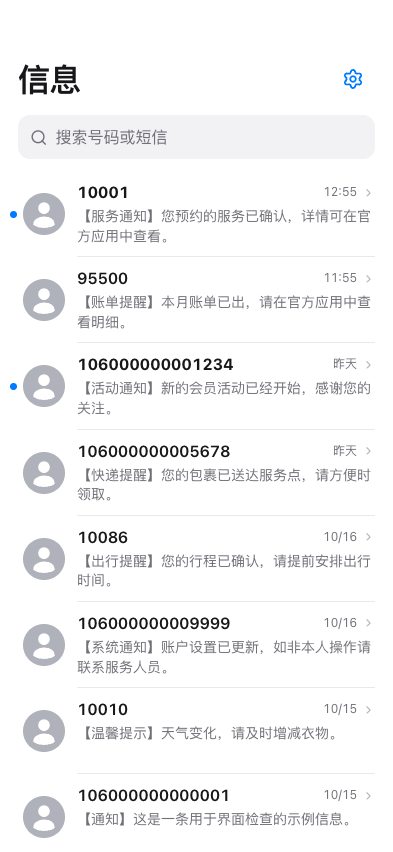
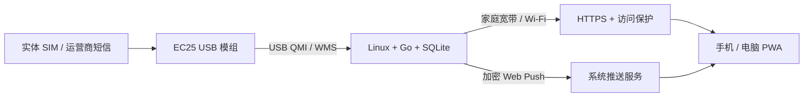

# SIM SMS PWA

把一张实体 SIM 留在家里的 Linux 设备上，用手机或电脑的 PWA 安全查看短信。

[English](README.en.md) · [硬件与购买指南](docs/HARDWARE.md) · [部署教程](docs/DEPLOYMENT.md) · [智能体构建提示词](AGENT_PROMPT.md)



## 能做什么

- EC25/QMI **只接收短信**，中文收件箱、搜索、会话阅读和深浅色主题。
- 可安装到 iPhone 主屏幕或电脑桌面；Web Push 锁屏提醒、发送方和内容预览、未读角标（取决于浏览器和系统）。
- 收到短信后立即进入持久化推送队列，失败重试；页面自动同步，无需点刷新。
- SQLite 本地存储，管理员登录；推送密钥、订阅和待发送内容加密保存。
- 可选 systemd 自动重启、定时健康检查及一致性备份。

**这不是 iMessage，也不是 Apple 官方产品。** 它不能把远端短信注入 iOS 系统“信息”，也不能让其他应用自动填入验证码。

## 接收链路



蜂窝模块必须注册运营商网络才能收短信，但本应用**不启动蜂窝数据会话、不设置 APN、不修改路由、不发送或删除短信**。网页、下载和推送走主机已有的以太网/Wi-Fi；Data Guard 检查到蜂窝默认路由时暂停向外推送。它不能代替运营商侧的数据禁用或管理其他软件的联网行为。

## 从哪里开始

1. **还没买硬件**：先看[选型和购买清单](docs/HARDWARE.md)，确认完整 EC25 USB 成品、地区频段及运营商短信支持。不要只买裸模块。
2. **先体验，不接设备**：按下方 mock 模式运行；这是模拟模式，不能证明真实收短信成功。
3. **树莓派接入真实 SIM**：按[完整部署教程](docs/DEPLOYMENT.md)操作，再完成运营商短信验收。
4. **让自己的智能体代装**：复制 [AGENT_PROMPT.md](AGENT_PROMPT.md)，在自己的环境提供主机访问授权，不要在聊天里发密码、验证码或密钥。

## 预编译安装包

[下载 v1.1.0 Linux ARM64 / amd64 安装包](https://github.com/tigerbryan/sim-sms-pwa/releases/tag/v1.1.0)，包含程序、原生安装器、配置示例、完整文档和第三方许可。

- Pi 5 / 64 位 Raspberry Pi OS 选 **linux-arm64**；常见 Intel/AMD Linux 选 **linux-amd64**。
- 下载对应 `.tar.gz` 和 `SHA256SUMS`，按[部署教程](docs/DEPLOYMENT.md#预编译安装包可选路径)校验，再解压安装。
- 生产用预编译包时无需 Go/Node；需要源码定制才按下方构建。发布包不能代替实际模组和 SIM 验收。

## 本地构建与体验

需要 Go（版本见 `go.mod`）、Node.js 24、npm；真实 QMI 设备接入需要 Linux。

```bash
git clone https://github.com/tigerbryan/sim-sms-pwa.git
cd sim-sms-pwa
make build
mkdir -p .private/demo/logs
QMI_WEB_BACKEND=mock ./build/qmi-web \
  --config config/config.example.yaml \
  --data .private/demo/data --logs .private/demo/logs
```

打开 `http://localhost:7580/sms`。**仅本机演示初始账户为 `admin / admin`，首次登录立即在网页设置中更换密码**；首次部署绑定回环地址，在更换密码和配置访问保护前不要暴露到局域网或公网。默认 mock 不访问真实模组。

```bash
go test -mod=vendor -buildvcs=false ./...
go vet -mod=vendor -buildvcs=false ./...
cd web && npm ci && npm test && npm run build
```

生产安装优先使用 Linux 原生 systemd：[详细步骤](docs/DEPLOYMENT.md)。公开的安装脚本只安装**你已构建并审查过的本地二进制**，不会以 root 权限拉取远程脚本或偷偷安装上游旧版。

## 兼容性和已知边界

| 项目 | 状态 |
| --- | --- |
| Raspberry Pi 5 + Linux + EC25-AUX USB / QMI | 项目来源环境使用此组合；你的 SIM/固件/运营商仍需单独验收 |
| Linux amd64 / arm64 | 提供构建路径与测试；模拟运行不能替代硬件测试 |
| 其他 EC25、EG25、SIM7600 等 | 不作兼容承诺；QMI 协议相同不等于应用已经验证 |
| Windows / macOS 作为模组服务器 | 本项目没有真实 QMI 后端支持；可作为网页客户端/开发机 |
| Synology DSM | 不承诺 USB 模组驱动支持；建议单独使用 Linux 主机 |
| iPhone 锁屏通知 | 需 HTTPS、添加到主屏幕并由用户点击允许；有网络和系统推送限制 |
| 秒推 | 应用及时入队，不保证运营商到达或手机展示时间；应测量实际延迟 |
| PWA 更新图标 | 更新资源不等于强制替换安装图标；系统行为见[说明](docs/PWA.md) |
| 永不关机 / 自动修复硬件 | 不保证；systemd 可恢复应用崩溃，断电/欠压/断网需供电和网络恢复 |
| SIP、拨打电话、发送短信、MMS | 本项目不实现 |

## 文档

- [硬件、购买链接与兼容性](docs/HARDWARE.md)
- [从装系统到收第一条短信](docs/DEPLOYMENT.md)
- [PWA、推送与远程访问](docs/PWA.md)
- [维护、升级、备份与恢复](docs/OPERATIONS.md)
- [智能体提示词](AGENT_PROMPT.md)
- [隐私和开源清理说明](docs/PRIVACY.md)
- [API 合约](docs/API_CONTRACT.md)、[安全模型](docs/SECURITY_MODEL.md)
- [上游来源和许可](NOTICE.md)、[第三方依赖](THIRD_PARTY_NOTICES.md)

## 来源与许可

基于 [xuanxuan1125/qmi-web](https://github.com/xuanxuan1125/qmi-web) 的 MIT 代码扩展，保留原许可与贡献者声明。本分支重点是移动收件箱、PWA/Web Push、接收可靠性与可复制部署。它不是对所有上游功能或设备兼容性的重新背书。

[MIT License](LICENSE)。供应商和 Apple 等名称仅用于说明兼容性；购买链接不含联盟返利参数，也不代表厂商与本项目存在合作。
